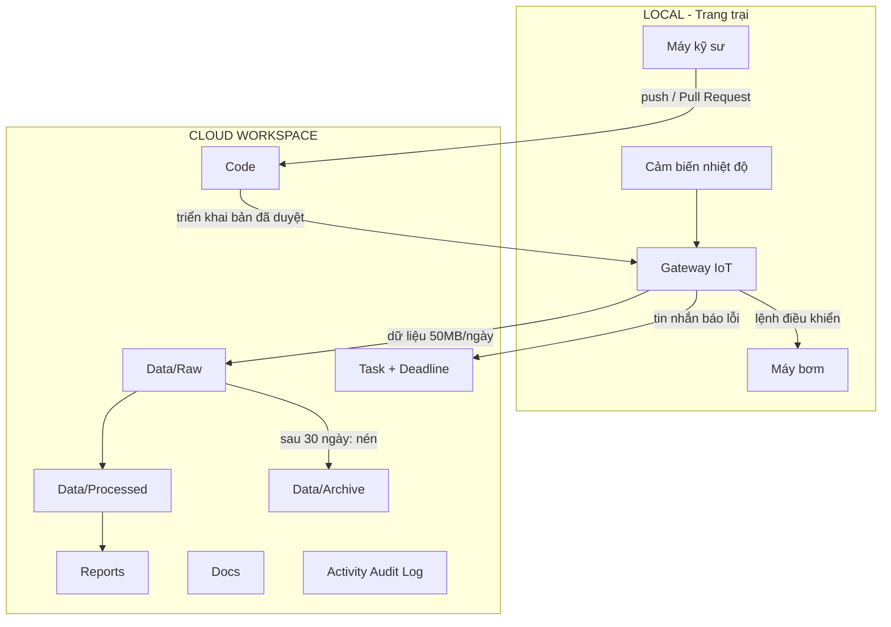

# Yêu cầu đầu ra
## Phần 1: Phân tích
### Sơ đồ phối hợp giữa Thiết bị IoT (Local) và Không gian cộng tác (Cloud)

| IPO | DIKW | Trong dự án |
|---|---|---|
| Input | Data | Nhiệt độ thô, tin nhắn báo lỗi từ cảm biến |
| Process | Information | Tổng hợp theo ngày (TB, min, max), lọc giá trị bất thường |
| Process | Knowledge | Source code điều khiển, tài liệu hướng dẫn, cách xử lý lỗi đã ghi lại |
| Output | Wisdom | Báo cáo, Task xử lý lỗi, quyết định mở rộng quy mô |

## Phần 2: Triển khai (README kiến trúc không gian cộng tác)
Nội dung file README này nằm trong:[README_Ex06.md](README_Ex06.md)
## Phần 3: Kiểm thử
### Quy trình 3 bước khi hệ thống bị rò rỉ dữ liệu (Data Leak)
| Bước | Hành động | Kết quả kiểm tra |
|---|---|---|
| 1. Thu hồi quyền (ngay lập tức) | Khóa và đặt lại mật khẩu tài khoản nghi vấn; gỡ mọi link chia sẻ; hạ quyền các nhóm liên quan xuống V hoặc "–"; đổi khóa của tài khoản dịch vụ gateway | Tài khoản nghi vấn không còn truy cập; không còn link công khai |
| 2. Kiểm tra Activity Audit Log | Lọc log theo người dùng nghi vấn, thư mục bị ảnh hưởng, khoảng thời gian từ trước lúc phát hiện; tìm hoạt động tải xuống, chia sẻ, đổi quyền, đăng nhập lạ; xác định ai, làm gì, lúc nào, dữ liệu nào bị lộ | Có danh sách sự kiện và phạm vi bị lộ; log được lưu vào `05_Admin/` |
| 3. Khắc phục và ghi nhận | Khôi phục quyền đúng theo mục 3 khi đã rõ nguyên nhân; đổi khóa/mật khẩu nếu nằm trong code; viết báo cáo sự cố (nguyên nhân, phạm vi, phòng ngừa) | Quyền khớp bảng phân quyền; báo cáo sự cố được lưu |

Thu hồi quyền làm **trước** để chặn rò rỉ tiếp diễn, xem log **sau** để biết mức thiệt hại.
